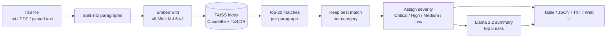

<div align="center">

# 🔍 Fineprint-AI

### Find the risky clauses hiding in Terms of Service, before you click "I agree".

An AI-powered **RAG** tool that reads a Terms of Service (text or PDF), matches every paragraph against two legal knowledge bases, rates each risky clause from **Low** to **Critical**, and explains the biggest risks in plain English using a local **Llama 3.2** model.


</div>

> ⚠️ **Disclaimer:** Fineprint-AI is for information only. It is **not legal advice** and can miss clauses or misread them. For important decisions, read the original text and talk to a qualified lawyer.

---

## 📑 Table of Contents

- [Why this project exists](#-why-this-project-exists)
- [Features](#-features)
- [How it works](#-how-it-works)
- [Severity levels](#-severity-levels)
- [Project structure](#-project-structure)
- [Installation](#-installation)
- [Usage](#-usage)
- [Web API](#-web-api)
- [Configuration](#-configuration)
- [Example output](#-example-output)
- [Limitations](#-limitations)
- [Troubleshooting](#-troubleshooting)
- [Roadmap](#-roadmap)

---

## 💡 Why this project exists

Almost nobody reads Terms of Service. They are long, written in legal language, and often hide important conditions such as:

- the company may **share or sell your data**,
- you **give up the right to sue** (forced arbitration, class-action waivers),
- the company can **change the terms at any time**,
- your content and activity are **tracked and reused**.

Fineprint-AI reads the whole document for you, highlights the paragraphs that look risky, tells you how serious each one is, and summarises the top issues in simple words.

---

## ✨ Features

| | Feature | Details |
|---|---------|---------|
| 📄 | **Text and PDF input** | Analyse `.txt` files, whole folders, pasted text, or PDFs up to 20 MB |
| 🧠 | **Semantic search (RAG)** | Matches by *meaning*, not keywords, so rephrased clauses can still be caught |
| 🚦 | **Risk levels** | Every flagged clause is rated `Critical`, `High`, `Medium` or `Low` |
| 🗣️ | **Plain-English summary** | Llama 3.2 explains the top 5 risks in 3 short bullets |
| 🖥️ | **CLI and Web UI** | Colour-coded terminal table, or a browser interface served by FastAPI |
| 📦 | **Export** | Save results as JSON or a readable text report |
| 🔒 | **Runs locally** | Embeddings and the LLM run on your machine, so your documents are not sent to external AI services |
| ⚡ | **Fast after first run** | The FAISS index is cached, so later runs start almost instantly |
| 🛟 | **Graceful fallback** | If Ollama is not running, the summary is skipped and the rest of the report still works |

---

## ⚙️ How it works



**Step by step**

1. **Knowledge base:** two legal datasets are embedded and stored in a FAISS index.
   - **Claudette**: sentences labelled as unfair or fair (Parquet file).
   - **ToS;DR**: community-reviewed cases and topics (`cases.csv` joined with `topics.csv` on `topic_id`).
2. **Chunking:** the input is split into paragraphs. Paragraphs longer than 800 characters are split further at sentence boundaries.
3. **Search:** each paragraph is embedded and compared with the knowledge base using cosine similarity (top 20 candidates).
4. **Filtering:** matches below the `--threshold` (default `0.70`) are dropped. For each paragraph, only the highest-scoring match **per category** is kept.
5. **Severity:** each match gets a risk level from its dataset label (see below).
6. **Summary:** the top 5 flags are sent to a local Llama 3.2 model to produce a 3-bullet explanation.
7. **Output:** results are printed as a colour-coded table, returned by the web API, or exported to a file.

---

## 🚦 Severity levels

| Colour | Severity | Meaning | Source label |
|:------:|----------|---------|--------------|
| 🔴 | **Critical** | Most serious risk to the user | ToS;DR `blocker` |
| 🔴 | **High** | Clearly unfavourable to the user | ToS;DR `bad` / Claudette label `0` |
| 🟡 | **Medium** | Neutral or worth a closer look | ToS;DR `neutral` |
| 🟢 | **Low** | Fair or favourable to the user | ToS;DR `good` / Claudette label `1` |

Each flag also has a **score** from 0 to 1. The score shows how closely the paragraph matches the knowledge-base entry (match confidence), not how dangerous the clause is. Severity tells you the risk, score tells you how sure the match is.

---

## 🗂️ Project structure

```
Fineprint-AI/
├── main.py                                         # RAG pipeline, CLI, FastAPI server, LLM summary
├── static/
│   └── index.html                                  # Web interface
├── 15012282/
│   ├── cases.csv                                   # ToS;DR cases
│   └── topics.csv                                  # ToS;DR topics (joined on topic_id)
├── train-00000-of-00001-a8de7efe0da36666.parquet   # Claudette unfairness dataset
├── requirements.txt                                # Python dependencies
├── .embeddings_cache/                              # Auto-generated FAISS cache (not in Git)
└── README.md
```

---

## 🛠️ Installation

### 1. Clone the repository

```bash
git clone https://github.com/muk997/Fineprint-AI.git
cd Fineprint-AI
```

### 2. Create a virtual environment (recommended)

```bash
# macOS / Linux
python3 -m venv .venv
source .venv/bin/activate

# Windows (PowerShell)
python -m venv .venv
.venv\Scripts\Activate.ps1
```

### 3. Install dependencies

```bash
pip install -r requirements.txt
```

> 💡 `torch` is the largest dependency. For a smaller CPU-only install:
> `pip install torch --index-url https://download.pytorch.org/whl/cpu`

### 4. Download the embedding model once

The app runs offline by default (`FORCE_HF_OFFLINE=true`), so the embedding model must be cached on your machine first. Run this **once while online**:

```bash
python -c "from sentence_transformers import SentenceTransformer; SentenceTransformer('all-MiniLM-L6-v2')"
```

### 5. (Optional) Enable AI summaries with Ollama

Install [Ollama](https://ollama.com/download), then:

```bash
ollama pull llama3.2:1b
ollama serve
```

Without Ollama everything still works. Only the plain-English summary is skipped.

---

## 🚀 Usage

### Command line

```bash
# Analyse a single file
python main.py path/to/Twitter_TermsofService.txt

# Analyse every .txt file in a folder
python main.py path/to/folder/

# Stricter or looser matching
python main.py path/to/Uber_TermsofService.txt --threshold 0.65

# Export as JSON
python main.py path/to/Uber_TermsofService.txt --output report.json

# Export as a readable text report
python main.py path/to/Uber_TermsofService.txt --output report.txt
```

> On Windows use `\` in paths (`text\Uber_TermsofService.txt`). On macOS/Linux use `/`. If `python` is not found on macOS/Linux, use `python3`.

| Flag | Default | Description |
|------|---------|-------------|
| `input` | required | Path to a `.txt` file or a folder of `.txt` files |
| `--threshold` | `0.70` | Minimum cosine similarity for a match. Lower finds more flags (more noise), higher finds fewer (more precise) |
| `--output` | none | Export path. `.json` for JSON, `.txt` for a formatted report |

### Web interface

```bash
uvicorn main:app --reload
```

Then open **http://127.0.0.1:8000** in your browser. You can paste text or upload a PDF and see the flags and summary.

The knowledge base loads on startup, so wait for the "KB ready" message in the terminal on the first run.

---

## 🌐 Web API

| Method | Endpoint | Description |
|--------|----------|-------------|
| `GET` | `/` | Serves the web interface |
| `POST` | `/upload-pdf` | Upload a PDF (max 20 MB). Returns the extracted `text` and page count |
| `POST` | `/analyze` | Analyse text. Returns summary, `risk_score`, and the list of flags |

**Analyse text**

```bash
curl -X POST http://127.0.0.1:8000/analyze \
  -H "Content-Type: application/json" \
  -d '{"text": "We may share your personal data with third parties.", "threshold": 0.70}'
```

**Response**

```json
{
  "summary": "...",
  "risk_score": 3,
  "flags": [
    {
      "severity": "High",
      "category": "Unfairness Detector",
      "source": "claudette",
      "score": 0.8123,
      "paragraph": "...",
      "description": "..."
    }
  ]
}
```

`risk_score` is the number of flags with severity `Critical` or `High`.

Interactive API docs are available at **http://127.0.0.1:8000/docs** while the server is running.

---

## 🔧 Configuration

Set these as environment variables.

| Variable | Default | Description |
|----------|---------|-------------|
| `EMBED_MODEL` | `all-MiniLM-L6-v2` | Sentence-transformers model used for embeddings |
| `LLM_MODEL` | `llama3.2:1b` | Ollama model used for the summary |
| `FORCE_HF_OFFLINE` | `true` | Blocks Hugging Face network access at runtime |

```bash
# Example: use a bigger Ollama model and allow model downloads
LLM_MODEL=llama3.2:3b FORCE_HF_OFFLINE=false python main.py my_tos.txt
```

---

## 📊 Example output

**Console table (CLI)**

| Severity | Category | Score | Paragraph |
|----------|----------|:-----:|-----------|
| 🔴 High | Unfairness Detector | 1.00 | *"Any use or reliance on any Content ... is at your own risk."* |
| 🟡 Medium | ... | 0.78 | ... |

**JSON export (`--output report.json`)**

```json
[
  {
    "file": "Twitter_TermsofService.txt",
    "elapsed_s": 6.94,
    "summary": "...",
    "flags": [
      {
        "severity": "High",
        "category": "Unfairness Detector",
        "source": "claudette",
        "score": 1.0,
        "paragraph": "...",
        "description": "..."
      }
    ]
  }
]
```

---

## 🚧 Limitations

Please keep these in mind when reading results:

- **Not legal advice.** The tool highlights suspicious clauses. It does not tell you what to do.
- **Misses are possible.** Matching is based on similarity. A clause worded very differently from anything in the knowledge base may not be flagged. *"No flags"* does not mean *"safe"*.
- **Small LLM.** `llama3.2:1b` is lightweight and can oversimplify or make mistakes. Always check the original clause shown in the table.
- **English only.** The datasets and models are built for English text.
- **PDFs need selectable text.** Scanned PDFs (images) will not work without OCR.
- **Severity comes from dataset labels.** It reflects how similar clauses were rated in Claudette and ToS;DR, not a judgment about your specific situation.

---

## 🩺 Troubleshooting

| Problem | Fix |
|---------|-----|
| `Model not cached locally: all-MiniLM-L6-v2` | Run the model download command in [Installation step 4](#4-download-the-embedding-model-once) while online, or set `FORCE_HF_OFFLINE=false` |
| `LLM unavailable: Failed to connect to Ollama` | Start Ollama with `ollama serve` and make sure the model is pulled. The rest of the report still works |
| `AttributeError: module '__main__' has no attribute 'KBEntry'` | The cache was created in a different run mode. Delete the `.embeddings_cache/` folder and start again |
| Server returns `503 Knowledge base is still loading` | Wait a few seconds for startup to finish and try again |
| `No extractable text found in this PDF` | The PDF is probably a scan. Copy the text manually or run OCR first |
| First run is slow | The knowledge base is being built. It is cached afterwards |

---

## 🗺️ Roadmap

- [ ] Overall document verdict (Low / Medium / High) in addition to per-clause levels
- [ ] OCR support for scanned PDFs
- [ ] Highlight flagged clauses directly inside the document view
- [ ] Support for Privacy Policies and other legal documents
- [ ] Multi-language support
- [ ] Compare two versions of a Terms of Service

---

## 🙏 Acknowledgements

- **[CLAUDETTE](http://claudette.eui.eu/)**: unfair clause detection dataset.
- **[ToS;DR](https://tosdr.org/)**: community-reviewed Terms of Service cases.
- **[Sentence-Transformers](https://www.sbert.net/)**, **[FAISS](https://github.com/facebookresearch/faiss)**, **[Ollama](https://ollama.com/)**, **[FastAPI](https://fastapi.tiangolo.com/)**.

Please check the original licenses of the datasets before reusing or redistributing them.

---

<div align="center">

**If this project helped you, consider giving it a ⭐ on GitHub.**

</div>
